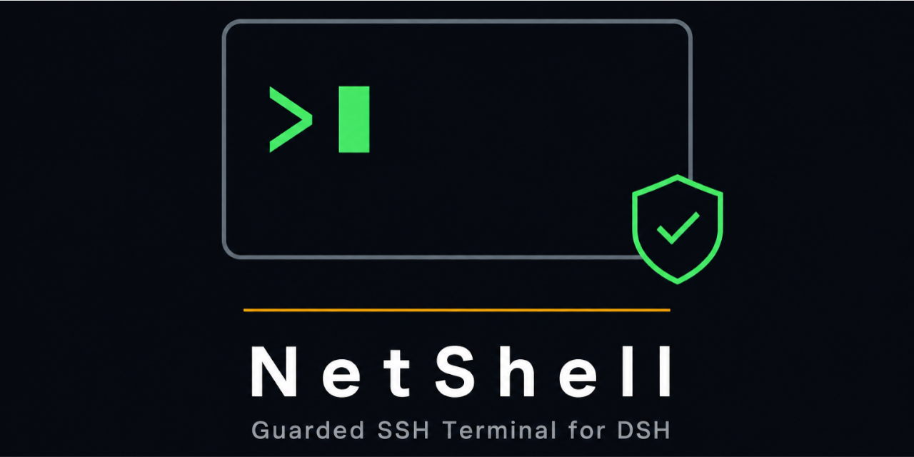

# DSH-NetShell

<p align="center">
  <a href="https://www.npmjs.com/package/@xgone/dsh-netshell"></a>
  <a href="https://www.npmjs.com/package/@xgone/dsh-netshell"></a>
  <a href="https://github.com/xgone/dsh-netshell/actions/workflows/ci.yml"></a>
  <a href="LICENSE"></a>
</p>

<p align="center"><a href="README.md">中文</a> · <a href="README.en.md">English</a> · <a href="README.ja.md">日本語</a> · <a href="README.es.md">Español</a> · <a href="README.fr.md">Français</a> · <strong>Deutsch</strong> · <a href="README.ru.md">Русский</a> · <a href="README.pt.md">Português</a></p>

<p align="center">
  
</p>

<p align="center"><strong>Ein bewachtes lokales und entferntes SSH-Terminal für DeepSeek Harness</strong></p>

Mit DSH-NetShell verwalten Sie Server, nutzen ein Live-Terminal und behalten vor riskanten Befehlen in DSH einen klaren menschlichen Kontrollpunkt. Menschliche Eingaben und KI-Aktionen teilen sich denselben Befehls-Guard. Die Oberflächentexte folgen dem Locale der DSH-Oberfläche und sind in Chinesisch, Englisch, Japanisch, Spanisch, Französisch, Deutsch, Russisch und Portugiesisch verfügbar.

## Funktionen

| Funktion | Was Sie erhalten |
| --- | --- |
| Lokales Terminal | Startet `bash`, `sh`, PowerShell oder `cmd` auf dem aktuellen Gerät ohne SSH-Einrichtung; unter Windows werden PowerShell/pwsh/cmd bevorzugt |
| Remote-SSH | Verwaltet Hosts, Ports, Benutzer und Authentifizierung über mehrere Sitzungen hinweg; unterstützt den Windows OpenSSH Client |
| Befehls-Guard | `allow` führt sofort aus, `ask` wartet auf die Freigabe, `deny` blockiert |
| Sichtbare Ausführung | Menschliche Eingaben und KI-Befehle erscheinen im selben Live-Terminalbereich |
| Isolierung der Anmeldedaten | SSH-Passwörter bleiben im verschlüsselten Speicher von DSH und gelangen nie in KI-Nachrichten, Tool-Ergebnisse oder Protokolle |
| Befehlsverlauf | Zeigt Zähler für ausgeführte, blockierte und erlaubte Befehle sowie jeden Entscheidungseintrag |
| Oberflächensprache | Chinesisch, Englisch, Japanisch, Spanisch, Französisch, Deutsch, Russisch und Portugiesisch, entsprechend dem Locale der DSH-Oberfläche |

## Installation

Veröffentlichtes Paket:

```bash
dsh plugin --profile web add @xgone/dsh-netshell
```

Aus einem lokalen Checkout:

```bash
dsh plugin --profile web add link:/path/to/dsh-netshell
```

Unter Windows installieren bzw. aktivieren Sie den Windows OpenSSH Client (`ssh -V` prüft die Verfügbarkeit); die Automatisierung gespeicherter Passwörter erfordert Unterstützung für `SSH_ASKPASS_REQUIRE=force` (OpenSSH 8.7+ empfohlen). Starten Sie DSH Web nach der Installation neu und öffnen Sie dann **Einstellungen → Terminal**.

## Schnellstart

### Lokales Terminal

1. Öffnen Sie im Hauptbereich den Tab **Terminal**.
2. Klicken Sie in der Zeile **Lokales Terminal** auf **Neu**.
3. Geben Sie Befehle ein und beobachten Sie die Live-Ausgabe.

Das lokale Terminal liest keine Remote-Profile und keine SSH-Passwörter.

### Entfernter Server

1. Öffnen Sie **Einstellungen → Terminal → Neu**.
2. Geben Sie Name, Host, Port und Benutzername ein.
3. Wählen Sie Passwort, privaten Schlüssel oder `ssh-agent` als Authentifizierung.
4. Wählen Sie eine Berechtigungsstufe; behalten Sie für eine erste Verbindung `guarded` bei.
5. Kehren Sie zum Tab **Terminal** zurück und klicken Sie in der Serverzeile auf **Verbinden**.

Ein gespeichertes Passwort wird nur als Konfigurationsstatus angezeigt und nie erneut ausgegeben. Unter Windows verwendet die Authentifizierung per privatem Schlüssel eine temporäre Kopie, die durch die ACL des aktuellen Benutzers geschützt ist; sie wird nach der Sitzung entfernt, und die ursprüngliche Schlüsseldatei samt ihrer ACL bleibt unverändert.

### Riskante Befehle

Befehle werden geprüft, wenn Sie die Eingabetaste drücken:

| Stufe | Verhalten |
| --- | --- |
| `open` | Alltägliche Nutzung; Regeln zum harten Blockieren gelten weiterhin |
| `guarded` (Standard) | Befehle mit hohem Risiko halten für eine Freigabe an |
| `locked` | Nur ausdrücklich erlaubte Befehle werden direkt ausgeführt |

Bei einem `ask`-Befehl wählen Sie **Einmal ausführen**, **Diesen Befehl immer erlauben** oder **Ablehnen**. Eine dauerhafte Erlaubnis gilt nur für den aktuellen Server und den exakten Befehlstext.

## UI-Vorschau


Die Fußzeile des Terminals zeigt Zähler für ausgeführte, blockierte und erlaubte Befehle. Öffnen Sie **Verlauf**, um Befehlsdatensätze zu prüfen. Der Wechsel zu einem anderen DSH-Tab trennt keine Hintergrundsitzung.

## KI-Tools

Das Plugin stellt zwei Modell-Tools bereit:

| Tool | Zweck |
| --- | --- |
| `netshell_servers` | Serverprofile ohne Passwörter auflisten |
| `netshell_run` | Einen Befehl auf einem ausgewählten Server ausführen |

KI-Befehle und menschliche Eingaben nutzen denselben Guard. `deny`-Befehle werden nie ausgeführt, und `ask`-Befehle erfordern eine Entscheidung von Ihnen in der DSH-Bestätigungsoberfläche oder im Terminalbereich. Die KI kann keine Passwörter sehen und keine Freigabeergebnisse fälschen.

Beim ersten Einsatz eines Servers durch eine Modellsitzung oder nachdem der Benutzer diesen Server manuell getrennt hat, fragt `netshell_run` vor dem Start von SSH eine Freigabe für die Remote-Verbindung an. Die Freigabe bleibt pro Modellsitzung und Server für die aktuelle Lebensdauer des Plugins erhalten; verschiedene Modellsitzungen müssen unabhängig freigeben, selbst wenn sie dieselbe SSH-Sitzung wiederverwenden. Ein Netzwerkfehler, ein SSH-Exit oder ein Verbindungstimeout löst nur für die bereits freigegebene Modellsitzung eine erneute Verbindung aus. Eine manuell geöffnete GUI-Sitzung ersetzt die Freigabe der Modellsitzung nicht. Ist der Bestätigungsdienst nicht verfügbar, schlägt das Plugin geschlossen fehl und verbindet nicht automatisch.

## Sicherheitsgrenze

Dies ist ein Betriebs-Guard, keine vollständige Sicherheits-Sandbox. Er schützt Befehle, die über das Terminal dieses Plugins und `netshell_run` eingehen; SSH-Verbindungen, die von anderen Plugins oder generischen Shell-Tools erstellt werden, liegen außerhalb seines Geltungsbereichs. Verwenden Sie `locked` für sensible Umgebungen und prüfen Sie Aktionen in interaktiven Programmen sorgfältig.

SSH-Hostschlüssel werden in der plugin-privaten Datei `$DSH_HOME/netshell/known_hosts` gespeichert (mit Rückfall auf `~/.dsh/netshell`, wenn `DSH_HOME` nicht gesetzt ist), getrennt von der Datei `~/.ssh/known_hosts` des Benutzers.

## Dokumentation

- [中文 README](README.md) · [English README](README.en.md) · [日本語 README](README.ja.md) · [Español README](README.es.md) · [Français README](README.fr.md) · [Русский README](README.ru.md) · [Português README](README.pt.md)
- [Aktualisierungen](UPDATES.md) · [中文](UPDATES.zh.md)
- [Technische Hinweise](TECHNICAL.md) · [中文](TECHNICAL.zh.md)
- [Leitfaden zum dynamischen Laden](DYNAMIC.md) · [中文](DYNAMIC.zh.md)
- [Design- und Host-Contract-Hinweise](DESIGN.zh.md)
- [Vollständiges historisches Changelog](CHANGELOG.md)

## FAQ

**Was sollte ich prüfen, wenn eine Verbindung fehlschlägt?** Prüfen Sie Host, Port, Benutzername und Authentifizierungsmethode. Wenn sich der Hostschlüssel geändert hat, bestätigen Sie, dass der Server absichtlich neu aufgesetzt wurde, bevor Sie den veralteten Eintrag aus der plugin-privaten `known_hosts`-Datei entfernen.

**Kann die KI mein Passwort sehen?** Nein. Der Host liest es nur beim Aufbau der SSH-Verbindung aus dem verschlüsselten Anmeldedatenspeicher von DSH; Profilauflistungen, Tool-Ergebnisse, Protokolle und Terminalausgaben enthalten den Passwortwert nie.