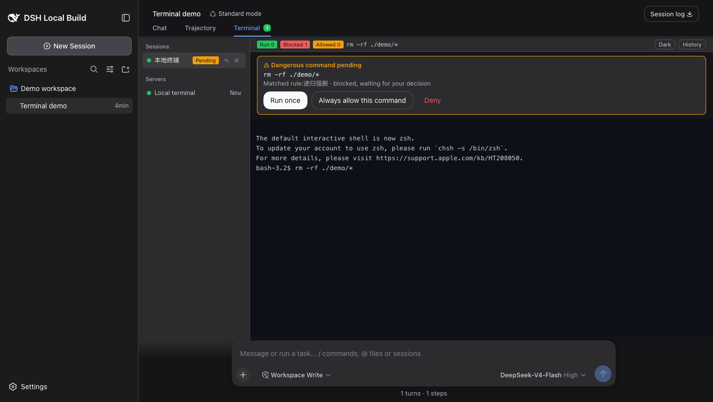

# DSH-NetShell

<p align="center">
  <a href="https://www.npmjs.com/package/@xgone/dsh-netshell"></a>
  <a href="https://www.npmjs.com/package/@xgone/dsh-netshell"></a>
  <a href="https://github.com/xgone/dsh-netshell/actions/workflows/ci.yml"></a>
  <a href="LICENSE"></a>
</p>

<p align="center"><a href="README.zh.md">中文</a> · <a href="README.md">English</a> · <a href="README.ru.md">Русский</a> · <a href="README.ja.md">日本語</a> · <a href="README.de.md">Deutsch</a> · <strong>Français</strong> · <a href="README.es.md">Español</a> · <a href="README.ko.md">한국어</a></p>

<p align="center">
  
</p>

<p align="center"><strong>Un terminal SSH local et distant avec garde-fou pour DeepSeek Harness</strong></p>

DSH-NetShell vous permet de gérer vos serveurs, de travailler dans un terminal en direct et de conserver un point de contrôle humain explicite avant l'exécution de commandes risquées dans DSH. La saisie humaine et les actions de l'IA passent par le même garde-fou de commandes. Les libellés de l'interface suivent la locale de l'interface DSH — chinois, anglais, russe, japonais, allemand, français, espagnol ou coréen.

## Points clés

| Capacité | Ce que vous obtenez |
| --- | --- |
| Terminal local | Lancez `bash`, `sh`, PowerShell ou `cmd` sur l'appareil courant sans configuration SSH ; sous Windows, PowerShell/pwsh/cmd sont privilégiés |
| SSH distant | Gérez hôtes, ports, utilisateurs et authentification avec plusieurs sessions ; prend en charge Windows OpenSSH Client |
| Garde-fou des commandes | `allow` s'exécute immédiatement, `ask` attend une validation, `deny` bloque |
| Exécution visible | La saisie humaine et les commandes de l'IA apparaissent dans le même panneau de terminal en direct |
| Isolation des identifiants | Les mots de passe SSH restent dans le stockage chiffré de DSH et n'entrent jamais dans les messages de l'IA, les résultats d'outils ou les journaux |
| Historique des commandes | Compteurs des commandes exécutées, bloquées et autorisées, plus l'enregistrement de chaque décision |
| Langue de l'interface | Chinois, anglais, russe, japonais, allemand, français, espagnol ou coréen, selon la locale de l'interface DSH |

## Installation

Paquet publié :

```bash
dsh plugin --profile web add @xgone/dsh-netshell
```

Depuis une copie locale des sources :

```bash
dsh plugin --profile web add link:/path/to/dsh-netshell
```

Sous Windows, installez/activez le client OpenSSH de Windows (`ssh -V` permet de vérifier sa disponibilité) ; l'automatisation avec mot de passe enregistré exige la prise en charge de `SSH_ASKPASS_REQUIRE=force` (OpenSSH 8.7+ recommandé). Redémarrez DSH Web après l'installation, puis ouvrez **Réglages → Terminal**.

## Démarrage rapide

### Terminal local

1. Ouvrez l'onglet **Terminal** dans la zone principale.
2. Cliquez sur **Nouveau** sur la ligne **Terminal local**.
3. Saisissez des commandes et suivez la sortie en direct.

Le terminal local ne lit ni les profils distants ni les mots de passe SSH.

### Serveur distant

1. Ouvrez **Réglages → Terminal → Nouveau**.
2. Saisissez un nom, un hôte, un port et un nom d'utilisateur.
3. Choisissez l'authentification par mot de passe, par clé privée ou par `ssh-agent`.
4. Choisissez un niveau d'autorisation ; conservez `guarded` pour une première connexion.
5. Revenez à l'onglet **Terminal** et cliquez sur **Connecter** sur la ligne du serveur.

Un mot de passe enregistré n'est affiché que sous forme d'état « défini » et n'est plus jamais révélé. Sous Windows, l'authentification par clé privée utilise une copie temporaire protégée par l'ACL de l'utilisateur courant ; cette copie est supprimée à la fin de la session, et le fichier de clé d'origine comme son ACL restent inchangés.

### Commandes risquées

Les commandes sont vérifiées lorsque vous appuyez sur Entrée :

| Niveau | Comportement |
| --- | --- |
| `open` | Usage quotidien ; les règles de refus strictes s'appliquent toujours |
| `guarded` (par défaut) | Les commandes à haut risque s'interrompent pour validation |
| `locked` | Seules les commandes explicitement autorisées s'exécutent directement |

Pour une commande soumise à `ask`, choisissez **Exécuter une fois**, **Toujours autoriser cette commande** ou **Refuser**. Une autorisation permanente ne s'applique qu'au serveur courant et au texte exact de la commande.

## Aperçu de l'interface



Le pied du terminal affiche les compteurs des commandes exécutées, bloquées et autorisées. Ouvrez **Historique** pour consulter les enregistrements de commandes. Passer à un autre onglet DSH ne déconnecte pas une session en arrière-plan.

## Outils pour l'IA

Le plugin expose deux outils de modèle :

| Outil | Rôle |
| --- | --- |
| `netshell_servers` | Liste les profils de serveurs sans les mots de passe |
| `netshell_run` | Exécute une commande sur un serveur sélectionné |

Les commandes de l'IA et la saisie humaine passent par le même garde-fou. Les commandes `deny` ne s'exécutent jamais, et les commandes `ask` exigent une décision de votre part dans l'interface de confirmation DSH ou dans le panneau du terminal. L'IA ne voit pas les mots de passe et ne peut pas falsifier le résultat d'une validation.

Lors de la première utilisation d'un serveur par une session de modèle, ou après que vous avez déconnecté manuellement ce serveur, `netshell_run` demande une validation de connexion distante avant de lancer SSH. Cette validation est conservée par couple session de modèle / serveur pendant toute la durée de vie du plugin ; des sessions de modèle différentes doivent valider indépendamment, même lorsqu'elles réutilisent la même session SSH. Une panne réseau, une sortie SSH ou un délai de connexion dépassé ne déclenche une reconnexion que pour la session de modèle déjà validée. Une session ouverte manuellement dans l'interface ne remplace pas la validation du modèle. Si le service de confirmation est indisponible, le plugin échoue en mode fermé et ne se connecte pas automatiquement.

## Périmètre de sécurité

Il s'agit d'un garde-fou opérationnel, et non d'un bac à sable de sécurité complet. Il protège les commandes qui entrent par le terminal de ce plugin et par `netshell_run` ; les connexions SSH créées par d'autres plugins ou par des outils shell génériques sortent de son périmètre. Utilisez `locked` pour les environnements sensibles et vérifiez avec attention les actions menées dans les programmes interactifs.

Les clés d'hôte SSH sont stockées dans le fichier `$DSH_HOME/netshell/known_hosts` privé au plugin (avec repli sur `~/.dsh/netshell` lorsque `DSH_HOME` n'est pas défini), séparément du `~/.ssh/known_hosts` de l'utilisateur.

## Documentation

- [中文 README](README.zh.md) · [English README](README.md) · [Русский README](README.ru.md) · [日本語 README](README.ja.md) · [Deutsch README](README.de.md) · [Español README](README.es.md) · [한국어 README](README.ko.md)
- [Mises à jour](UPDATES.md) · [中文](UPDATES.zh.md)
- [Notes techniques](TECHNICAL.md) · [中文](TECHNICAL.zh.md)
- [Guide du chargement dynamique](DYNAMIC.md) · [中文](DYNAMIC.zh.md)
- [Notes de conception et de contrat hôte](DESIGN.zh.md)
- [Journal complet des modifications](CHANGELOG.md)

## FAQ

**Que vérifier lorsqu'une connexion échoue ?** Vérifiez l'hôte, le port, le nom d'utilisateur et la méthode d'authentification. Si la clé d'hôte a changé, assurez-vous que le serveur a bien été réinstallé volontairement avant de supprimer l'entrée obsolète du fichier `known_hosts` privé au plugin.

**L'IA peut-elle voir mon mot de passe ?** Non. L'hôte le lit dans le stockage d'identifiants chiffrés de DSH uniquement au moment d'établir SSH ; les listes de profils, les résultats d'outils, les journaux et la sortie du terminal ne contiennent jamais la valeur du mot de passe.
